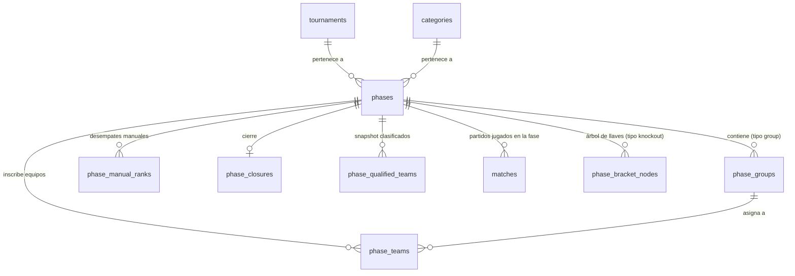
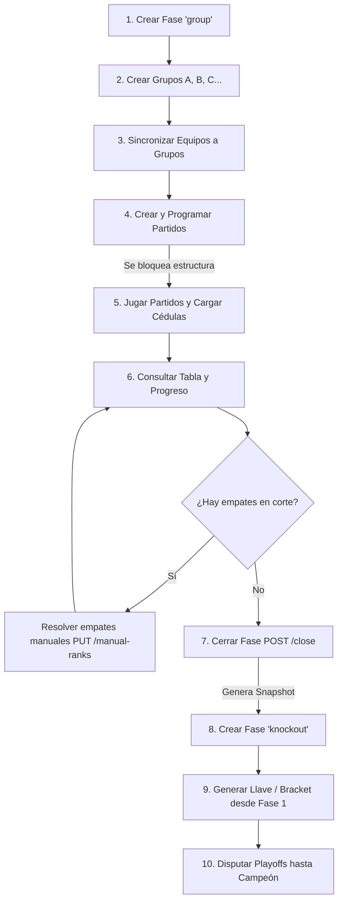

# tournament-api — Documentación del Sistema de Fases

Este documento detalla la arquitectura, el diseño conceptual, el modelo de datos, la lógica de desempates y el ciclo de vida completo del módulo de **Fases** (`phases`) en `tournament-api`.

---

## 1. Filosofía de diseño y concepto

Una **Fase** (`Phase`) representa una etapa competitiva concreta dentro de una categoría (`Category`) de un torneo deportivo (`Tournament`).

### ¿Por qué se diseñó así?

1. **Flexibilidad multiformato:**
   Los torneos reales no tienen un solo formato rígido. Algunos son torneos largos (Liga todos contra todos), otros son copas (Fase de Grupos $\rightarrow$ Eliminatoria directa / Playoffs), y otros tienen rondas previas o reclasificaciones. Una categoría puede tener múltiples fases ordenadas cronológicamente (`sortOrder`).

2. **Tipos de fase soportados (`PhaseType`):**
   - `group`: Fase dividida en grupos (ej. Grupo A, Grupo B). Cuenta con tablas de posiciones independientes por grupo, desempates automáticos/manuales y cálculo de clasificados.
   - `knockout`: Eliminatoria directa (Playoffs / Liguilla / Cuadro de llaves) con partidos únicos o ida y vuelta, y cruce de tercer lugar. Se nutre normalmente de los clasificados de una fase previa.
   - `league`: Formato de liga con tabla única todos contra todos.

3. **Inmutabilidad y Determinismo (Snapshot de Clasificados):**
   Uno de los principios centrales es que **los clasificados a la siguiente fase se congelan en una foto estática (`phase_qualified_teams`) al momento de cerrar la fase**. Si semanas después se corrige una cédula arbitral o se edita un marcador en fase de grupos, **no se alteran retroactivamente los equipos clasificados ni se rompen las llaves ya sorteadas**.

4. **Bloqueo estructural (`PhaseStructureGuardService`):**
   En cuanto una fase tiene al menos un partido registrado (`matches`), la estructura queda **congelada** (`PHASE_STRUCTURE_LOCKED`). Ya no se pueden crear/eliminar grupos ni alterar los equipos asignados a ellos para evitar inconsistencias en el calendario y estadísticas.

5. **Persistencia de decisiones humanas:**
   Los desempates que las matemáticas y los resultados directos no logran resolver (ej. sorteo o fair play) requieren intervención del organizador. Estas decisiones se almacenan en una tabla dedicada (`phase_manual_ranks`) para no perderse si se reconfiguran equipos o se recalculan tablas.

---

## 2. Modelo de datos y tablas

El módulo interactúa con 6 tablas en PostgreSQL (definidas en `src/modules/phases/infrastructure/database/schema.ts`):

### Detalle de tablas

| Tabla | Propósito | Notas clave |
|---|---|---|
| `phases` | Entidad raíz de la fase. | Contiene `type` (`group`, `knockout`, `league`), `status` (`upcoming`, `active`, `finished`), fechas y `sortOrder`. |
| `phase_groups` | Grupos dentro de una fase de grupos (ej. "Grupo A"). | Solo permitidos si `type === 'group'`. |
| `phase_teams` | Asignación de equipos de la categoría a la fase y al grupo. | Llave única `(phase_id, team_id)`. Incluye `seed` opcional. |
| `phase_manual_ranks` | Desempates manuales decididos por el administrador. | `scope`: `'group'` (empate intragrupo) o `'best_next'` (empate entre mejores terceros/segundos). |
| `phase_closures` | Auditoría de cierre de fase de grupos. | Registra la configuración usada: `qualifiers_per_group`, `best_next_count`, quién cerró y cuándo. |
| `phase_qualified_teams` | **Snapshot inmutable** de los clasificados. | Guarda: `team_id`, `phase_group_id`, `position`, `via` (`group` \| `best_next`), puntos y diferencia de goles al momento del cierre. |

---

## 3. Lógica de posiciones y desempates

Toda la computación analítica vive en `domain/services/` como funciones puras y deterministas.

### 3.1. Tabla de posiciones por grupo (`group-standings.ts`)

Para cada grupo, se toman únicamente los partidos en estado `finished` entre equipos del mismo grupo.

El ordenamiento y desempate se resuelve en el siguiente orden estricto:

1. **Mayor cantidad de puntos** (3 por victoria, 1 por empate, 0 por derrota).
2. **Mejor diferencia de goles** ($\text{GF} - \text{GC}$).
3. **Mayor cantidad de goles a favor** ($\text{GF}$).
4. **Head-to-head (Enfrentamiento directo):**
   - Si 2 o más equipos siguen empatados en los pasos 1–3, el sistema aísla a esos equipos y genera una **mini-tabla** únicamente con los partidos disputados entre ellos.
   - Aplica los criterios 1–3 sobre esa mini-tabla.
5. **Desempate manual del administrador:**
   - Si tras el head-to-head el empate persiste, el sistema consulta `phase_manual_ranks` con `scope = 'group'`.
6. **Empate no resuelto (`tieGroup`):**
   - Si no hay decisión manual completa, a esos equipos se les asigna un identificador `tieGroup` numérico.

### 3.2. Clasificación y mejores segundos/terceros (`qualification.ts`)

Al consultar o cerrar la fase con una configuración dada (`perGroup` y `bestNext`):

1. **Clasificados directos:** Los primeros `perGroup` equipos de cada grupo obtienen su pase con `via: 'group'`.
2. **Candidatos a mejores restantes:** El equipo que queda en la posición `perGroup + 1` de cada grupo (ej. el 3° si pasan 2) entra al ranking `bestNextRanking`.
3. **Criterio entre grupos:** Al no haber enfrentamiento directo entre grupos distintos, se ordenan por:
   - Puntos $\rightarrow$ Diferencia de goles $\rightarrow$ Goles a favor $\rightarrow$ Desempate manual (`scope = 'best_next'`).
4. **Validación de empates en la línea de corte (`pendingTies`):**
   - Si hay un empate no resuelto entre el último que clasificaría y el primero que quedaría fuera (sea dentro de un grupo o en la tabla de mejores terceros), el sistema genera un **`pendingTie`**.
   - **El sistema impide cerrar la fase mientras existan `pendingTies`.** El administrador debe desempatar primero.

---

## 4. Ciclo de vida completo de una fase

El flujo de trabajo operacional sigue estos pasos:

### Paso 1: Creación de la fase
Se crea mediante `POST /tournaments/:tournamentId/categories/:categoryId/phases`.
- Solo el `OWNER` del torneo puede crearla.
- Se valida que la categoría pertenezca al torneo.
- Se valida que la categoría no tenga su campeonato cerrado (`CategoryClosedError`).

### Paso 2: Creación de grupos y asignación de equipos
- Se crean grupos con `POST /phases/:phaseId/groups`.
- Se asignan equipos mediante `PUT /phases/:phaseId/teams` (`syncPhaseTeams`), pasando el arreglo completo de `{ teamId, phaseGroupId, seed }`.
- Valida que todos los equipos pertenezcan a la categoría de la fase.

### Paso 3: Disputa de partidos y bloqueo estructural
- Al generarse partidos asociados a la fase (`phaseId`), `PhaseStructureGuardService` activa el bloqueo.
- No es posible añadir o remover grupos ni cambiar las asignaciones de equipos mientras existan partidos.

### Paso 4: Revisión de clasificados y desempates
- `GET /phases/:phaseId/standings?perGroup=2&bestNext=2` devuelve:
  - Tablas por grupo con indicador de partidos esperados vs. jugados.
  - Clasificados tentativos.
  - Lista de `pendingTies` si hay empates críticos sin resolver.
- Si hay empates, el admin envía `PUT /phases/:phaseId/standings/manual-ranks` indicando el orden relativo de los equipos empatados (`rank: 1`, `rank: 2`, etc.).

### Paso 5: Cierre de la fase (`ClosePhaseUseCase`)
- Se ejecuta `POST /phases/:phaseId/close` con `{ perGroup, bestNext }`.
- **Condiciones obligatorias:**
  1. Todos los partidos de la fase deben estar en estado `finished` (`PhaseNotCompleteError`).
  2. No deben quedar empates pendientes en los puestos de clasificación (`PhaseHasPendingTiesError`).
  3. La fase no debe haber sido cerrada previamente.
- **Efecto:**
  - El estado de la fase pasa a `finished`.
  - Se registra el cierre en `phase_closures`.
  - Se genera el snapshot definitivo en `phase_qualified_teams`.

### Paso 6: Conexión con eliminatorias (`brackets`)
- Se crea una fase siguiente de tipo `knockout`.
- Se invoca `POST /phases/:knockoutPhaseId/bracket/generate` indicando `sourcePhaseId` (la fase de grupos cerrada).
- El sistema toma los equipos de `phase_qualified_teams`, calcula los sembrados (`seeds`) de mayor a menor rendimiento y arma el bracket de eliminatoria automática (octavos, cuartos, semis, final, etc.).

### Paso 7: Reapertura de fase (`ReopenPhaseUseCase`)
- Si un admin necesita reabrir una fase cerrada para corregir algo:
  - `POST /phases/:phaseId/reopen`
  - **Restricción de seguridad:** Si ya se generó un bracket a partir de esta fase (`existsBySourcePhaseId`), la reapertura se rechaza con `PhaseHasBracketError`. Se debe borrar el bracket primero antes de poder reabrir la fase de grupos.

---

## 5. Matriz de Endpoints

Todas las rutas privadas requieren cookie de sesión (`requireAuth`). Las acciones de estructura y cierre requieren rol `OWNER`.

| Método | Ruta | Auth / Rol | Descripción |
|---|---|---|---|
| `GET` | `/v1/tournaments/:tId/categories/:cId/phases` | Pública | Lista las fases de una categoría ordenadas por `sortOrder`. |
| `POST` | `/v1/tournaments/:tId/categories/:cId/phases` | OWNER | Crea una fase en la categoría. |
| `GET` | `/v1/phases/:id` | Pública | Obtiene el detalle de una fase. |
| `PATCH` | `/v1/phases/:id` | OWNER | Edita metadatos de la fase (nombre, fechas, estado, sortOrder). |
| `DELETE` | `/v1/phases/:id` | OWNER | Elimina una fase (falla si tiene partidos creados). |
| `GET` | `/v1/phases/:phaseId/groups` | Pública | Lista los grupos de la fase. |
| `POST` | `/v1/phases/:phaseId/groups` | OWNER | Crea un grupo (falla si la fase ya tiene partidos). |
| `PATCH` | `/v1/phase-groups/:id` | OWNER | Edita el nombre o sortOrder de un grupo. |
| `DELETE` | `/v1/phase-groups/:id` | OWNER | Elimina un grupo (falla si la fase tiene partidos). |
| `GET` | `/v1/phases/:phaseId/teams` | Pública | Lista los equipos inscritos y sus grupos asignados. |
| `PUT` | `/v1/phases/:phaseId/teams` | OWNER | Sincroniza en lote los equipos y grupos asignados. |
| `GET` | `/v1/phases/:phaseId/standings` | Pública | Calcula y devuelve las posiciones por grupo, progreso y simulación de clasificados. |
| `PUT` | `/v1/phases/:phaseId/standings/manual-ranks` | OWNER / ADMIN | Establece el orden manual para resolver empates (`group` o `best_next`). |
| `POST` | `/v1/phases/:phaseId/close` | OWNER | Cierra la fase de grupos y genera el snapshot de clasificados. |
| `POST` | `/v1/phases/:phaseId/reopen` | OWNER | Reabre una fase cerrada (siempre que no tenga brackets generados). |
| `GET` | `/v1/phases/:phaseId/bracket` | Pública | Obtiene los nodos del bracket de una fase eliminatoria. |
| `POST` | `/v1/phases/:phaseId/bracket/generate` | OWNER | Genera el bracket a partir de una fase de grupos cerrada (`sourcePhaseId`). |

---

## 6. Manejo de Errores Específicos del Dominio

| Código de Error | HTTP Status | Razón |
|---|---|---|
| `PHASE_STRUCTURE_LOCKED` | 409 | Se intentó modificar grupos o equipos en una fase que ya tiene partidos programados. |
| `PHASE_HAS_MATCHES` | 409 | No se puede borrar la fase porque contiene partidos. |
| `STANDINGS_NOT_AVAILABLE` | 400 | Se solicitaron tablas o cierres en una fase que no es de tipo `group`. |
| `PHASE_NOT_COMPLETE` | 409 | Se intentó cerrar la fase sin haber finalizado todos los partidos de los grupos. |
| `PHASE_HAS_PENDING_TIES` | 409 | Se intentó cerrar la fase con empates sin resolver en posiciones que definen clasificación. |
| `PHASE_ALREADY_CLOSED` | 409 | La fase ya se encuentra en estado `finished` / cerrada. |
| `PHASE_NOT_CLOSED` | 409 | Se intentó reabrir una fase que no estaba cerrada. |
| `PHASE_HAS_BRACKET` | 409 | No se puede reabrir la fase porque ya existe una llave/bracket creada que depende de ella. |
| `CATEGORY_CLOSED` | 409 | El campeonato de la categoría ya concluyó; no se admiten nuevas fases ni modificaciones estructurales. |
